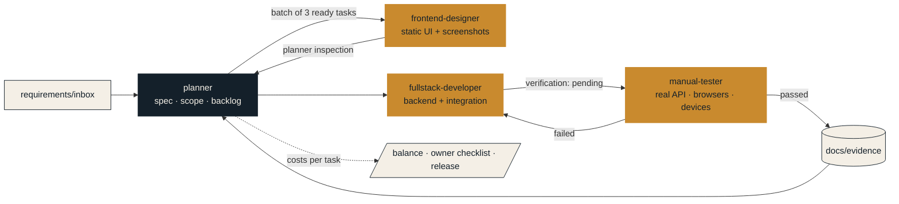

<p align="center">
  <picture>
    <source media="(prefers-color-scheme: dark)" srcset="assets/brand/horizontal/shipwright-horizontal-white.svg">
    
  </picture>
</p>
<p align="center"><strong>A Claude Code plugin for production-grade delivery</strong></p>
<p align="center">
  <a href="LICENSE"></a>
  
  
  <a href="https://github.com/sponsors/vebg"></a>
</p>

*The shipwright builds what has to survive the sea.* Shipwright is a way of releasing production-grade software with Claude Code: a planner that turns requirements into a traceable backlog, three delivery agents that work one at a time, and evidence gating every task before it ships.

Two plugins extracted from a real product delivery — requirements to store-ready mobile apps, web hosts and an API, built by four Claude Code agents over one traceable backlog with evidence for every task:

| Plugin | What it gives you | Install id |
|---|---|---|
| [`shipwright`](plugins/shipwright/README.md) | The workflow: `planner` as the main session, `frontend-designer`, `fullstack-developer`, `manual-tester` and an optional `store-compliance-reviewer`; `/shipwright:start` intake; guard hooks; token-cost tracking; workspace scaffold with templates and the protocol docs; optional project-level wiring for Hindsight memory and context-mode | `shipwright@shipwright` |
| [`shipwright-devices`](plugins/shipwright-devices/README.md) | Pinned `mobile-mcp` server for driving local iOS simulators and Android emulators | `shipwright-devices@shipwright` |

## Who it is for
Shipwright is written first for experienced developers. Anyone can run it — the intake interview asks about the product, the stack and the way of working, and the agents do the building — but it pays off most when you already know how to ship software: you choose technologies you are familiar with, you can read the deliverables and evidence the agents hand back, you notice when a plan or a build is wrong, and you can answer the questions the planner raises instead of guessing. If you are new to software, it still works as a guided path: pick a stack the agents know well, keep the scope small, read every evidence file, and expect to learn as you go.

## Install
```bash
claude plugin marketplace add vebg/shipwright
claude plugin install shipwright@shipwright
# optional
claude plugin install shipwright-devices@shipwright
```
Then open Claude Code in the folder where your product's workspace should live and run `/shipwright:start`.

## Recommended companions (not bundled, both optional)
| Tool | What it adds | How the kit uses it |
|---|---|---|
| [Hindsight](https://github.com/vectorize-io/hindsight) coding-agent memory (`@vectorize-io/hindsight-coding-agents`, self-hosted server or cloud) | Long-term project memory: knowledge pages, reflect, session capture, git-history seeding | `/shipwright:start memory` scaffolds the **project-level** wiring (tracked `.hindsight/coding-agent.json` with one bank per workspace, hooks and env in `.claude/settings.json`, the `hindsight` MCP servers in `.mcp.json`, ignore lines, the companion skill); every agent carries `mcp__hindsight` and a "Project memory" section that treats memory as a past record, never as current state |
| [context-mode](https://github.com/mksglu/context-mode) plugin (`context-mode@context-mode`) | Runs builds, logs, curl bodies and big files in a sandbox and returns only the derived lines; indexes long documents | Every agent carries `mcp__plugin_context-mode_context-mode` and a "Context budget" section; the scaffold writes `CONTEXT_MODE_DIR` and the ignore line when you say yes |

Hindsight ships its own Claude Code plugin (hooks, MCP server, skill); this kit does not re-bundle it. The project-level wiring exists because the owner's repositories keep one memory bank and one log folder per workspace, with the config under version control.

## What is inside
| Module | Command / file | What it does |
|---|---|---|
| Intake | `/shipwright:start` | Discovery interview in rounds (product, users, surfaces, inspiration links/videos, technologies, constraints, brand, working agreement — including the tests trade-off), then the scaffold |
| Planning & delivery | `:plan` `:design` `:develop` `:verify` `:resume` `:status` | Requirements → traceable backlog → design parts → integration → manual verification with evidence |
| Balance | `/shipwright:balance` | Every task with status, group (feature or priority band) and cost; totals, statistics, forecast, optional budget warnings |
| Doctor | `/shipwright:doctor` | Machine and workspace checks with fix commands (tools, kit files, repos, Hindsight, context-mode, hooks, mobile tooling) |
| Owner checklist | `/shipwright:owner` | What the owner must do to release: versions since the last deployed one, env lines, migrations, store steps, open questions |
| Questions | `/shipwright:questions` | The open-questions table with defaults and how to answer |
| Release | `/shipwright:release` | Versioning ADR, per-task tags via the rendered `scripts/release-tag.sh`, release notes, store "what's new" brief |
| Evidence helpers | `scripts/contact_sheet.py`, `scripts/record.sh` | Labelled contact sheets and short MP4 recordings for inspection and chat updates |
| Chat updates | `docs/CHAT-UPDATES.md` | How progress, blockers and owner items go to a chat plugin (Telegram) |
| Guards & cost hooks | `hooks/hooks.json` | Designer-only skills/agents, denied test and destructive commands, token cost after every run |
| Evals | `plugins/shipwright/evals/` | `claude plugin eval` cases: intake opens, status reports, tests policy holds |
| Example | `examples/sample-workspace/` | A scaffolded workspace with a small planned backlog and a discovery file, to read before your first interview |

## How a task moves

Design parts are closed by the planner's inspection; everything behavioural is verified by the tester on real runs; a failed verification goes back to the developer, never to the designer. Every agent run is attributed to its task and costed.

## The method in one paragraph
Requirements go into an inbox; the planner catalogs every source, writes a spec with stable IDs, scope, architecture, decisions and diagrams, and a dependency-ordered backlog whose acceptance criteria are observable manual checks. You say go per batch (three tasks). The designer delivers static-first UI — markup, styles, every state as a design route, real screenshots — and the planner closes it by inspection. The developer builds the backend and the whole integration and hands over with evidence. The tester verifies on the real API, browsers and devices, including negative, authorization and concurrency paths, and records evidence; only then is a task done. Every agent run is attributed to its task and costed. Nothing is pushed, deployed or purchased by an agent.

## Local development of this marketplace
```bash
claude plugin validate .                      # marketplace + every plugin
claude --plugin-dir ./plugins/shipwright    # one session with the plugin, without installing
claude plugin marketplace add ./              # install from the local checkout (in-place; /reload-plugins after edits)
```

## Publishing
Set your GitHub user in the two `plugin.json` files and the READMEs (`vebg`), push, and users add the marketplace with `claude plugin marketplace add <user>/shipwright`. Plugin names are permanent once published; raise `version` in each `plugin.json` on every release (or omit it to track commits). Submission to Anthropic's directory is per plugin folder from the developer portal; `docs/PUBLISHING.md` lists the constraints this layout respects and the two reviewer holds to expect.

## Support the project
Shipwright is free and Apache-2.0-licensed. If it saves you a release or two, you can [sponsor @vebg on GitHub](https://github.com/sponsors/vebg) ☕ (one-time or monthly; GitHub takes no fee from individual sponsorships).

## Licence
Apache License 2.0 (see [LICENSE](LICENSE) and [NOTICE](NOTICE)). Third-party tools these plugins configure, launch or recommend (mobile-mcp, Hindsight, context-mode, the design skills the designer may use) keep their own licences and are not bundled.
